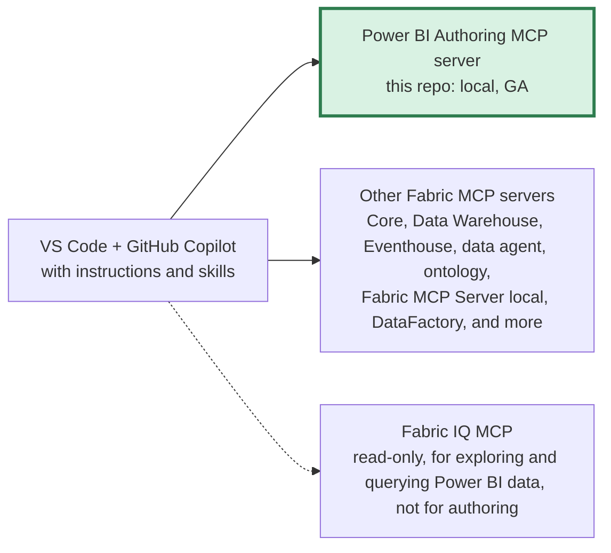
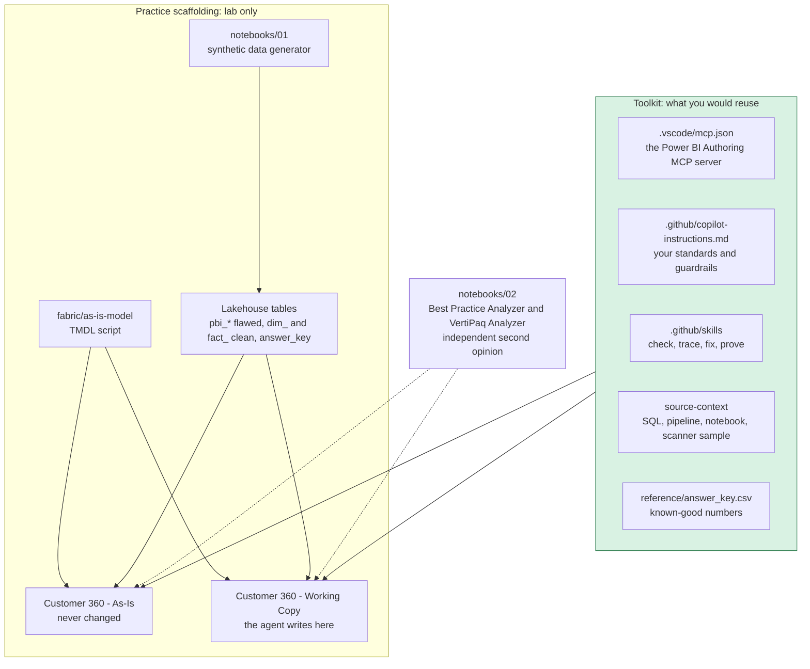

# 🕵️ Semantic Model MCP Lab
## Check, fix and prove your Power BI semantic model with an AI agent | VS Code + the Power BI Authoring MCP server

> 💡 **Heads up**: this is a personal side project, not an official Microsoft resource. Opinions and instructions are my own.
> For official guidance, see [Microsoft Learn](https://learn.microsoft.com) and the
> [official Skills for Fabric repo](https://github.com/microsoft/skills-for-fabric).

Hi there! 👋🏽 This repo is for anyone who wants to learn **how to use the Fabric MCP servers to check their data**,
and more specifically to check a Power BI semantic model. It uses **VS Code** and **GitHub Copilot** as the place you
work, the **Power BI Authoring MCP server** as the tool the agent uses to look inside the semantic model, and **synthetic data**
so you can try everything safely before you point it at anything real.

A note on words: **model** in this repo always means a Power BI **semantic model**. When I mean the AI, I say **AI model**.

<p align="center"></p>

Based on Microsoft Learn: 👉 [**Power BI Authoring MCP server**](https://learn.microsoft.com/en-us/power-bi/developer/mcp/power-bi-authoring-mcp)

---

## 🎯 What you'll be able to do

After working through this repo you will be able to:

- 🔎 Run a **read-only health check** of a semantic model, with the DAX evidence behind every finding
- 🧭 **Trace** each problem back to the SQL view, pipeline or notebook where it starts
- 🛠️ Apply **approved fixes** to a working copy in one transaction, and show that no number moved
- ✅ **Prove** the semantic model still gives the right answers by matching an answer key
- 🧩 Explain **where the Fabric MCP servers fit**, and what is still your job when an agent does the reviewing

---

## 🧩 The Big Picture: the Fabric MCP Servers

People say "the Fabric MCP" as if there is one server with others tucked underneath it. That is not how Microsoft documents it.
Microsoft Learn keeps a **directory** called [Choose a Microsoft Fabric MCP server](https://learn.microsoft.com/en-us/rest/api/fabric/articles/mcp-servers/fabric-mcp-servers-list).
Every row is its own separate server, some hosted by Microsoft (remote) and some that you run yourself (local), and your agent can use more than one.
"Fabric MCP Server (local)" is just the name of one row in that list.

> Here is an analogy 💡 Think of VS Code and GitHub Copilot as a **phone**, and each MCP server as a **separate app** on it.
> You decide which apps to install. They do not live inside one master app.

The diagram, the sources and the details are in [docs/how-the-fabric-mcp-servers-fit-together.md](docs/how-the-fabric-mcp-servers-fit-together.md). The short version:



- **This repo uses one server:** the Power BI Authoring MCP server, local deployment. Learn tells you not to register the hosted and local versions at the same time, because the agent then sees two overlapping sets of tools.
> **Why local and not hosted?** Microsoft's [Power BI Authoring MCP server page](https://learn.microsoft.com/en-us/power-bi/developer/mcp/power-bi-authoring-mcp) says to use the hosted server when your environment supports it, because there is nothing to install and Microsoft manages updates. It is in **Preview**, and it needs a tenant setting ("Users can use the Power BI Model Context Protocol server endpoint") that a Fabric admin turns on. This repo uses the **local** server, which is generally available, and which adds transactions and traces that the hosted one does not have. If your tenant allows the hosted server, try it. Don't register both at the same time.
- **It is for building and reviewing semantic models, not for answering business questions.** Learn says: "Don't use the Power BI Authoring MCP server for consumption scenarios." For that, Microsoft points to Fabric IQ.

---

## 📦 What's in the Repo and How the Pieces Fit

The repo has two halves. One half is **practice scaffolding**: it gives you a safe semantic model with known problems to work on. The other half is the **toolkit**: the pieces you would actually reuse on your own semantic models.



| Path | What it is | Lab only, or reusable? |
|---|---|---|
| `notebooks/01_Generate_Synthetic_C360.ipynb` | Fabric notebook that writes the as-is (`pbi_*`), gold (`dim_*`, `fact_*`) and `answer_key` tables to a lakehouse | Lab only |
| `notebooks/c360_synthetic.py` | Same generator for local use (pandas + numpy). Keep it out of the agent's workspace | Lab only |
| `fabric/as-is-model/` | A script that generates the flawed as-is model as TMDL (Import mode, planted issues), and a script that resets the working copy | Lab only |
| `notebooks/02_BPA_and_Memory_Check.ipynb` | Runs the Best Practice Analyzer and the VertiPaq (memory) analyzer from Semantic Link Labs against the semantic models. The agent explains and fixes; the analyzer counts | Reusable idea. Point it at your own semantic models |
| `vscode-workspace/` | **Open this folder in VS Code.** It holds `.vscode/mcp.json`, `.github/copilot-instructions.md` and the skills | Reusable. This is the toolkit |
| `vscode-workspace/source-context/` | Synthetic SQL views, stored procedure, pipeline definition, Fabric notebook and scanner sample: the raw material for the trace step. The copy in `source-context/` at the repo root is the same files **with comments that explain each planted problem**, so keep that one out of the folder the agent can read | Replace with your own |
| `vscode-workspace/reference/answer_key.csv` | Known-good numbers for the prove step | Replace with your own |
| `setup/`, `Demo_Prompt_Pack.md` | Setup steps, troubleshooting, license summary, and every prompt in order with expected results. `setup/Planted_Issues_Answer_Key.md` lists the 16 planted problems: **don't put it in the folder you open in VS Code**, or the agent can read the answers | Docs |
| `docs/` | The MCP server diagram, the "make it yours" guide and the workspace picture (yes, it has a hat) | Docs |

### The semantic models and tables, and how they differ

Three things in this lab look like "the model", and they are not the same:

| | **Customer 360 - As-Is** | **Customer 360 - Working Copy** | **Gold tables** (`dim_*`, `fact_*`) |
|---|---|---|---|
| What it is | A semantic model (Import mode) | A semantic model (Import mode) | Delta tables in the lakehouse. **Not** a semantic model |
| Built from | The six `pbi_*` tables: flat, e-mail keyed, flawed on purpose | The same TMDL, deployed under a different name | A clean star schema: 7 dimensions and 5 facts |
| Planted issues | 16 | 16 on day one, then whatever the agent fixes | None. It is the target shape |
| Who may change it | Nobody. The agent's instructions protect it by name | The agent, after you approve a written plan | Nobody. The notebook generates it |
| Used for | **Check** and **trace**. It is also your before picture | **Fix** and **prove** | The source of the answer key, and what "already fixed upstream" looks like in the trace step |
| Reset | Never needed | `fabric/as-is-model/reset_working_copy.ps1` | Re-run notebook 01 |

**As-Is and Working Copy are identical until the agent touches the Working Copy.** After the fix step in this repo, the Working Copy has 14 columns hidden, `PostalCode` set to Summarize By None, four measures in a "Measures" folder, and a description on each of the six tables. Every total stays exactly the same.

**As-Is versus the gold tables.** The gold tables are what the same data looks like when the problems are solved at the source:

| In the as-is model | In the gold tables |
|---|---|
| Every table joins on the e-mail text | Integer keys, plus an Unknown customer member for readers who are not customers |
| One wide customer table mixing attributes and frozen totals | A customer dimension with attributes only. Totals become measures over the facts |
| 65 spellings of 43 markets, different in every table | One Market dimension |
| Ticket price as text, `Y`/`N` and `TRUE`/`FALSE` flags, postal code as a number | Fixed-decimal money, real true/false flags, postal code as text |
| Date-times down to the second | Real dates, and web activity at a daily grain (per customer, day, market and device) |
| Currency stored as floating point | Fixed decimal |
| No measures, no descriptions | Not part of the tables. These live in the semantic model |

---
## 🏠 Why This Lab Exists

Most real semantic models do not start as a design. They start as a quick report on top of a few SQL views, and then the report becomes a dependency.
Here are some things I see often, for example:

- Every table joins on **e-mail**, a long text string, because that was the one column all the systems had in common
- A **wide customer table** that mixes descriptions with numbers that were frozen by a nightly job
- Market or region names that **differ by source system** ("Miami" in one place, "South Florida" in another), so totals quietly split
- Numbers stored as **text**, currency stored as **floating point**, date-times where only the date is ever used
- **No measures, no descriptions**, and cryptic column names like `sub_sts` and `plan_prc`

Reviewing all of that by hand takes time, and the review is only as good as who has time to do it. An agent can help: it is fast, it does not get bored, and it can show its evidence.
But an agent that changes your semantic model without proof is a risk, not a help. So this lab is as much about the **guardrails** as it is about the agent.

> Here is another analogy 💡 Think of the check step as a **home inspector**. They walk through, write down every issue and show you photos. They do not start knocking down walls.
> The fix step is the **contractor**, who only starts after you approve the quote, and the prove step is the **final walkthrough** where you check that the house still has the same number of rooms.

---

## 📚 The Story: Check, Trace, Fix, Prove

```
THE FOUR SECTIONS
------------------------------------------------------------------
1. CHECK   Read-only health check of the as-is model. The agent lists issues with
           evidence (the DAX it ran and the result) for each one.
2. TRACE   The agent reads the SQL views, the nightly procedure, the pipeline and the
           gold notebook, and says where each problem starts, not just where it shows.
3. FIX     After you approve a written plan, it applies only the safe fixes to a
           WORKING COPY, in one transaction, and shows a before/after table.
4. PROVE   It answers business questions and matches an answer key computed
           independently in pandas.
------------------------------------------------------------------
Rule: a number that should not change must not change. If it does, stop and revert the change.
```

### Why this looks like the real thing

| What teams really have | What this lab gives you |
|---|---|
| A semantic model built piece by piece from SQL views and stored procedures into "pbi" tables | `source-context/sql` has those views and the nightly procedure; the semantic model imports the `pbi_*` tables |
| A long text key (e-mail) joining everything | All five relationships use `Email` |
| A newer gold layer that already fixed some of this | `source-context/fabric-notebooks` shows the fix; the lakehouse `dim_*` / `fact_*` tables are the gold layer |
| A table with the Power BI scanner output | `source-context/scanner` shows what that table records |
| Market names that differ by source | 65 spellings for 43 markets |
| Millions of customers | Scales from 20k to 600k customers. The default is 150k |

⚠️ **Scale note:** real semantic models can have millions of rows, which is where slowness really shows up. The default here is 150,000 customers so a run is fast.
Use the `large` scale (600,000) if you want to feel the difference.

---

## ✅ Prerequisites

| Requirement | Notes |
|---|---|
| **VS Code** | Current version. I built and tested this on 1.141. Older versions that still use the Local agent can use `vscode-workspace/legacy-prompts` |
| **GitHub Copilot + Copilot Chat** | In **Agent mode**. Learn recommends a deep-reasoning AI model, because the AI model you pick has a large effect on result quality |
| **Power BI Authoring MCP server (local)** | Windows or Linux, not macOS. Install through `npx` (needs [Node.js](https://nodejs.org/en)) or the VS Code extension |
| **A Fabric workspace** | On an F SKU or trial capacity, with the **XMLA endpoint set to Read Write** |
| **Permissions** | **Write** permission on the semantic model to change it. With **Build** only, the server can run queries but not make changes |
| **Python 3** (optional) | To run the data generator locally. Not needed if you run the notebook in Fabric |

⚠️ If you use GitHub Copilot through an organization, check that **MCP servers in Copilot** is enabled. Learn notes it is off by default for enterprise accounts and an administrator has to turn it on.

---

## 🛠️ Step-by-Step Setup Guide

### Step 1 - Create the Fabric Workspace
1. Create a workspace called **🕵️ Model Detective Agency** (any name works, but the prompts use this one)
2. Put it on an F SKU or trial capacity
3. In the capacity's Fabric admin settings, set the **XMLA endpoint to Read Write**

⚠️ Why Read Write? The local MCP server connects to the semantic model through the XMLA endpoint. Read-only XMLA allows queries but not changes.

---

### Step 2 - Generate the Synthetic Data
1. Create a lakehouse called `LH_C360_Lab` and set it as the default lakehouse of notebook 01
2. Import and run `notebooks/01_Generate_Synthetic_C360.ipynb`. At the default scale it takes about 5 minutes
3. Compare the `answer_key` table with the numbers in `vscode-workspace/reference/answer_key.csv`

---

### Step 3 - Create the semantic models
1. Run `fabric/as-is-model/gen_asis_tmdl.py` with your lakehouse SQL endpoint to generate the TMDL
2. Create two semantic models from it: **Customer 360 - As-Is** (never changed) and **Customer 360 - Working Copy** (the agent's fixes go here)
3. In each semantic model: Settings, then Gateway and cloud connections, and map to a connection (SQL Server, OAuth 2.0, sign in, leave SSO unchecked). Then refresh

⚠️ A refresh fails with "default data connection without explicit credentials" until you do the mapping. The API cannot set those credentials for you, so this one is a manual click.

---

### Step 4 - Read and Accept the License Terms
Read [setup/EULA_and_Data_Terms.md](setup/EULA_and_Data_Terms.md) and the real terms linked there. The agent will ask you to confirm it again at the start of each session.
I do not accept the terms for you: please do not add `--accept-eula` to `mcp.json` until you have read them.

---

### Step 5 - Set Up VS Code
Follow [setup/VSCode_Setup_and_Connect.md](setup/VSCode_Setup_and_Connect.md). The short version:
1. Install GitHub Copilot, then open the `vscode-workspace` folder
2. `.vscode/mcp.json` registers the server as `powerbi-authoring-local`. It starts the server with `npx`, the way Microsoft Learn documents it. If you installed the VS Code extension and prefer it, copy `.vscode/mcp.extension-example.json` over it and fill in your path
3. Open Chat in **Agent** mode and untick every tool except `powerbi-authoring-local`

⚠️ **Common gotcha:** in my testing the MCP server would not start until I had sent at least one message in the chat ("Cannot start an MCP server before the session runtime has been created"). Send a message first, then start the server.

---

### Step 6 - Run the Check
1. Connect to the semantic model (the prompt is in `setup/VSCode_Setup_and_Connect.md`)
2. Type `/model-health-check` and pick it from the list
3. Read each confirmation before you approve it

Expected on connect: 6 tables, 72 columns, 0 measures.

---

### Steps 7-9 - Trace, Fix and Prove
Follow `Demo_Prompt_Pack.md`.

---

## 🔎 How the Check Works (and What Is AI Judgment vs. Hard Numbers)

`/model-health-check` is a **skill** (a saved slash command) in `vscode-workspace/.github/skills/model-health-check`. It is not a built-in analyzer and not a feature of the MCP server.
It is a well-written request, and the reason I like it is that it separates two things:

1. **Inventory and evidence are facts.** The agent reads the semantic model through the server's tools (tables, columns, relationships, measures, calculated-column expressions) and then runs read-only DAX queries against the live semantic model. If the agent ran the query, the number is right.
2. **Judgment is AI.** The AI model compares those facts with the checklist in `.github/copilot-instructions.md` and decides what is an issue and how serious it is. That part can be wrong, which is why every finding has to show the DAX behind it.
3. **A coverage table at the end** shows which checks actually ran, so a skipped check is visible instead of silent.

It changes nothing. The skill says read-only, the agent's instructions only allow writes to a semantic model whose name contains "Working Copy" or "Gold", and `--require-confirmation` asks before each query or change.

> In one line 💡 the agent **measures first, then judges**. The numbers come from queries you can rerun, and every recommendation comes with its evidence.

---

## 🔒 What an Agent Speeds Up, and What You Still Own

This is the part I care about most. In my best run the agent found all 16 planted problems in one sitting, with every finding backed by a query I could rerun.
But **the agent did not replace the work. It moved it.**

| The agent speeds up | You still own | Where I see it (Microsoft docs, or my own runs) |
|---|---|---|
| Reading every table, column, relationship and measure | **Knowing your data.** The agent found 65 market names and grouped the obvious ones into about 50 (the real number is 43). Whether "Miami" and "South Florida" are the same thing is a business decision it correctly left to me | My runs: it put market grouping and orphan-row handling under "Needs a design decision" |
| Writing and running dozens of DAX checks | **Checking the evidence.** Every finding shows its DAX so you can rerun it. The agent also overstated one number by counting orphan rows | My runs. Microsoft also says the AI model you pick has a large effect on result quality and recommends a deep-reasoning AI model |
| Applying a long list of changes in one go | **Deciding what to change.** It plans first and waits for "approved". Changes made through the XMLA endpoint are hard to undo | Learn: "An agent writes to your model, and its changes might be irreversible", so back up the semantic model and work in PBIP files under Git |
| Following a checklist | **Building the skill.** The tools are *what the agent can do* and the skills are the *guidance*. My first four runs got 11 to 13 of 16 because my instructions never reached the agent. After I fixed that it found 16 of 16 | Learn's Power BI Agentic overview: "Skills tell the agent what to do. Tools let the agent do it." Skills are static files, and the AI tool decides what to do with them |
| Working at the speed of a script | **Governance.** The agent acts with *your* permissions. It does not expand your access, but it does move data: the semantic model's metadata and query results go to the AI model provider behind your client. Training and retention depend on your plan and the AI model you pick (see "Where to Run This") | Learn: use least-privilege Fabric roles. Some safeguards are not standardized in MCP. Review the security of the host, client, agent and AI model provider, and your own data-handling policies |

Here are the things I would not skip:

1. **Build your own skills and instructions.** Microsoft's skills are general. Yours should say what "good" means for *your* semantic models and what the agent must never do. That is what `.github/copilot-instructions.md` and `.github/skills` are for in this repo.
2. **Know your data before you ask an agent about it.** The agent can tell you the orphan rows are there. It cannot tell you why, or whether they should be dropped.
3. **Get a second opinion.** An agent review is not a certification. `notebooks/02_BPA_and_Memory_Check.ipynb` runs the Best Practice Analyzer from Semantic Link Labs as an independent check.
4. **Keep humans in the approval loop.** Plan, approve, apply, prove. Never the other way around.
5. **Run it where it is safe:** a dev or test copy, masked or synthetic data, least privilege, a backup, and your source in Git. See the next section.
6. **Review the legal and security terms** of the MCP server, the client and the AI provider before real data goes anywhere near them.

---

## Where to Run This: Dev or Test, Never Production

The agent runs DAX queries against the semantic model and can change it. So:

- **Use a dev or test copy of the semantic model**, on a dev workspace and (ideally) a separate capacity. The DAX can be heavy, and on production it competes with the people who rely on that semantic model.
- **Use sampled or masked data.** The semantic model's metadata and query results go to the AI model provider behind your Copilot client, and the license terms say data may be processed outside your region. Whether that data can be used to *train* an AI model depends on your Copilot plan and the AI model you pick. GitHub's [Hosting of models for GitHub Copilot](https://docs.github.com/en/copilot/reference/ai-models/model-hosting) page says GitHub does not use Copilot Business or Enterprise customer data to train AI models, while for individual plans (Free, Pro, Pro+ and Max) interaction data may be used for training unless you opt out. Check your plan, the AI model and your organization's AI policy. This lab uses synthetic data only.
- **Start read-only** (`--readonly`) for the check. Switch to read-write with `--require-confirmation` only on the working copy.
- **Give the signed-in user the least permission needed.** Changing a semantic model needs Write permission; Build permission only allows queries.
- **Writes are permanent.** A semantic model changed through the XMLA endpoint can no longer be downloaded as a .pbix. Microsoft's guidance is to back up the semantic model before you start and to work in PBIP files under Git, so every change the agent makes shows up as a diff you can review and revert.
- **Check the semantic model, not the raw layers.** The target is the semantic model and the tables it imports (gold, or views like `pbi_*`), not silver.

---

## Why Skills and Not Prompt Files (this one cost me an afternoon)

I first wrote the slash commands as **prompt files** (`.github/prompts/*.prompt.md`). In VS Code 1.141 the Copilot chat runs on **Agent Host**, and the
[VS Code docs](https://code.visualstudio.com/docs/agent-customization/prompt-files) say prompt files are **not loaded** there. There is no error: the slash command just does not exist,
so the agent improvises from the words "health check" and your numbered list is never delivered. In my first four runs the agent found 11 to 13 of 16 planted issues.
After converting the prompts to **skills** (`.github/skills/<name>/SKILL.md`) it found all 16.

- The commands in this repo are skills. Type `/` in Chat and pick the command from the list (don't paste the text).
- The first line of the health check is "Health check prompt v4 loaded." If you do not see it, the skill was not delivered.
- If you are on an older VS Code that still uses the Local agent, the original prompt files are in `vscode-workspace/legacy-prompts`: copy them to `.github/prompts`.
- If a command is missing, run **Developer: Reload Window**, then check `/skills`.

---

## 🌱 Make It Yours: Turn This into Your Own Toolkit

Everything above is practice on synthetic data. The real goal is that **you** take the toolkit, point it at your own semantic models, and end up with something your team owns: your standards, your checks and your known-good numbers. Here is how I would do it.

### What to keep, and what to leave behind

| Piece | In your own setup? | Why |
|---|---|---|
| Notebook 01 (data generator), the as-is TMDL script, the reset script | **No.** Practice only | They exist to create a safe semantic model with known problems. Your real semantic models already have real ones |
| Notebook 02 (Best Practice Analyzer and VertiPaq) | **Yes**, read-only, against a dev or test copy | It is an independent second opinion on the agent. Microsoft also offers sample notebooks from a semantic model's details page (under **Model health**), so you may not need ours at all |
| `.vscode/mcp.json` | **Yes** | It registers the server. Nothing in it is specific to this lab |
| `copilot-instructions.md` | **Yes, but rewrite it** | It holds *your* standards: naming, star schema rules, what must be hidden, what the agent must never do |
| The four skills | **Yes, then tune them** | They are a working starting point. Your semantic models will show you what to add |
| `source-context/` | **Yes, with your own files** | The trace step is only as good as the SQL, pipelines and notebooks you give it |
| `reference/answer_key.csv` | **Yes, with your own numbers** | The prove step needs answers you trust from somewhere other than the semantic model |

### Getting started in seven steps

1. **Pick one semantic model to start with.** A dev or test copy of one your team knows well, so you can tell when the agent is wrong. Not production.
2. **Copy the toolkit into your own Git repo.** Take the `vscode-workspace` folder. Keep the names: `.github/copilot-instructions.md` and `.github/skills/<name>/SKILL.md`.
3. **Write your standards into the instructions file.** Naming conventions, what a good star schema looks like for you, what must be hidden, how measures are documented, how you name protected semantic models, how data is masked, and what the agent must never do.
4. **Run the check and read it like a skeptic.** Compare it with what you already know about the semantic model. Write down what it missed and what it got wrong. Run the Best Practice Analyzer as a second opinion.
5. **Turn every miss into an instruction.** If it skipped a comparison, add that comparison as a numbered item in the skill, and ask for a coverage table so a skipped check is visible.
6. **Add your source context.** Copy (read-only, no secrets) the SQL views, stored procedures, pipeline definitions and notebook code behind the semantic model into `source-context/`. For the model side, the [metadata scanner APIs](https://learn.microsoft.com/en-us/fabric/governance/metadata-scanning-overview) return table and column names, measures, DAX expressions and mashup queries for semantic models. A Fabric admin has to set scanning up first.
7. **Write your own answer key.** Pick 10 to 15 business questions where you trust the number from a source other than the semantic model, such as a finance report or a SQL query. Put them in `reference/answer_key.csv` and point the prove skill at them.

Then work in the same four sections: **check, trace, fix on a working copy, prove**. Approve every change, back up the semantic model first, and keep your source files in Git.

The longer version, with a skill skeleton, where skills live and how to score your own runs, is in [docs/make-it-yours.md](docs/make-it-yours.md).

> My suggestion (not Microsoft guidance) 💡 Treat your skills like code. Keep them in Git, review changes through a pull request, give them a version (this repo's health check says "v4 loaded" on its first line), and score every new version against a known list before you trust it.

---
## What Is GA and What Is Preview (checked Oct 12-13, 2026)

| Piece | Status |
|---|---|
| Power BI Authoring MCP server, **local** (runs on your machine) | GA. Windows and Linux, not macOS |
| Power BI Authoring MCP server, **hosted** | Preview |
| Skills for Fabric (agent guidance on top of the server) | Preview |
| Copilot in Power BI web modeling | Preview |

Microsoft Learn is mid-rename: the server was the Power BI **Modeling** MCP server, and some pages still use that name. It is the same project.
See [Sources_and_Status.md](Sources_and_Status.md) for the Microsoft Learn links. I flag anything that comes from the community, and I do not claim more than the docs do.

---

## Safety Notes

- `--readonly` blocks all writes. In read-write mode I start the server with `--require-confirmation` so it asks first. The server's own help text says confirmation prompts are skipped by default without that flag.
- The agent's instructions only allow writes to a semantic model whose name contains "Working Copy" or "Gold"
- Every finding must show the DAX query that produced it
- Personal data is masked in chat, even though it is synthetic
- This repo does not redistribute the MCP server. It only links to the official install

---

## Decision Guide: Which Path Should You Pick?

```
START
  |
  +-- Do you need to review and improve an existing semantic model?
  |   +-- Yes -> CHECK (read-only), TRACE to the source, FIX a working copy, PROVE the numbers
  |   +-- Building a new semantic model instead? See vscode-workspace/optional
  |
  +-- Can you use a dev/test copy with masked data?
      +-- No  -> stop. Do not point an agent at production
      +-- Yes -> continue
          +-- Want to try it with no VS Code and no GitHub Copilot?
              +-- Yes -> try Copilot web modeling (Preview) in the browser
              +-- No  -> this lab (VS Code + Power BI Authoring MCP server, local, GA)
```

---

## Related Repositories

| Repository | What it does |
|---|---|
| [powerbi-authoring-vscode-quickstart](https://github.com/roholub/powerbi-authoring-vscode-quickstart) | A field guide for building Power BI **reports** from natural language with Skills for Fabric and GitHub Copilot CLI |

---

## Disclaimer

This repo is MIT licensed (see [LICENSE](LICENSE)). That covers the files here only. The Power BI Authoring MCP server is Microsoft software under its own license terms, which you read and accept yourself (see [setup/EULA_and_Data_Terms.md](setup/EULA_and_Data_Terms.md)).

This repository is a personal project and is not affiliated with, endorsed by, or associated with Microsoft Corporation or any of its subsidiaries.
All views and code expressed here are my own. The data is synthetic. The summary of the license terms is not legal advice. Please read the terms yourself.
Microsoft, Power BI, Fabric and related marks are trademarks of Microsoft Corporation.

---

*Author: Rocio Holub - [github.com/roholub](https://github.com/roholub/)*