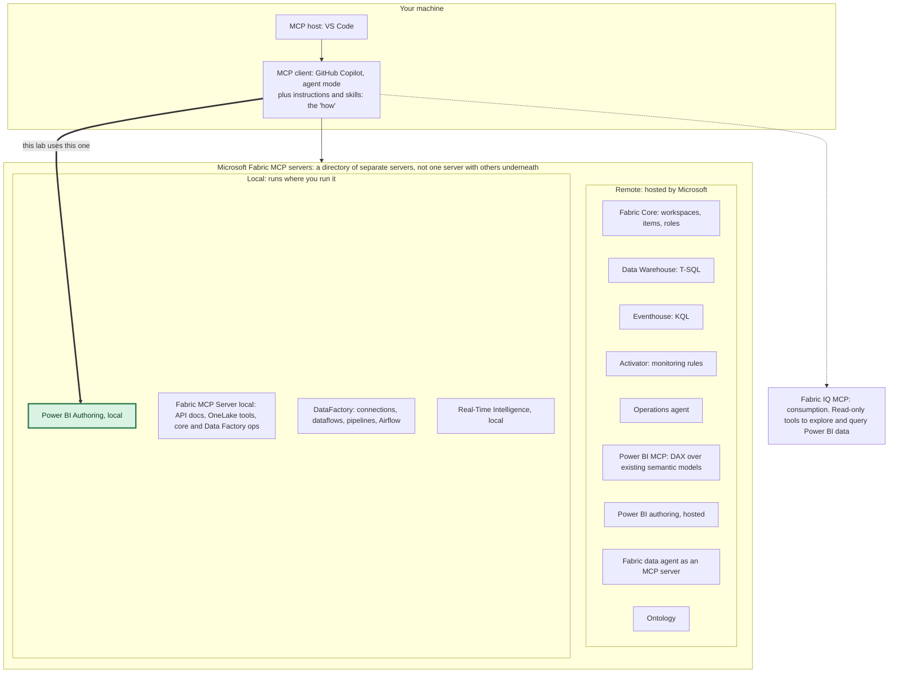

# How the Fabric MCP servers fit together (and where this lab sits)

Checked against Microsoft Learn on Oct 13, 2026. Pages used, with their "last updated" dates:
- [Choose a Microsoft Fabric MCP server](https://learn.microsoft.com/en-us/rest/api/fabric/articles/mcp-servers/fabric-mcp-servers-list) (updated Sep 23, 2026)
- [Overview of the Power BI MCP servers](https://learn.microsoft.com/en-us/power-bi/developer/mcp/mcp-servers-overview) (updated Sep 29, 2026)
- [Power BI Authoring MCP server](https://learn.microsoft.com/en-us/power-bi/developer/mcp/power-bi-authoring-mcp) (updated Sep 29, 2026)
- [Power BI Agentic overview](https://learn.microsoft.com/en-us/power-bi/developer/agentic/power-bi-agentic-overview) (updated Oct 5, 2026)
- [Skills for Fabric overview](https://learn.microsoft.com/en-us/fabric/fundamentals/skills-for-fabric-overview) (updated Sep 29, 2026)

Product pages change. Re-check them before you rely on anything here.

## The one thing to get right: it is a family of servers, not one server with others underneath

When people say "the Fabric MCP", they usually mean one of two things, and it is easy to mix them up:

1. **A directory.** Microsoft Learn keeps a list called "Choose a Microsoft Fabric MCP server". Each row is its **own, separate server** with its own setup page. Nothing is nested under a master server. Learn says "an agent can use more than one server when its MCP client supports that configuration."
2. **One specific server.** The row named **"Fabric MCP Server (local)"** is a single server for developing Fabric solutions (API documentation, OneLake tools, core and Data Factory operations). It does not contain the others. Semantic model authoring is a different row in the directory.

So the accurate picture is a **host and client on your machine talking to whichever servers you register**:

Notes on the diagram:
- The servers are the ones in the Learn directory as of the date above. Fabric IQ is listed on the Power BI overview page, and the directory points to it under related integrations.
- "Remote" and "local" describe where the server runs, not where your AI model processes data. Learn says that explicitly.
- **Authoring is one server with two deployment options** ([Power BI MCP overview](https://learn.microsoft.com/en-us/power-bi/developer/mcp/mcp-servers-overview)): hosted (Preview) and local (generally available). Learn tells you to **avoid registering both at once**, because the agent then sees two overlapping tool sets.
- Naming is mid-change. The Fabric directory page still lists the same local server as "Power BI Modeling MCP server", and the npm package is still `@microsoft/powerbi-modeling-mcp`. The Power BI pages call it "Power BI Authoring MCP server".

## Which one do you use for what

| You want to | Use | Status on the Power BI pages |
|---|---|---|
| Review, change or document a semantic model | Power BI Authoring MCP server | Local: generally available. Hosted: preview |
| Work with a semantic model open in Power BI Desktop, or with PBIP/TMDL files, transactions, traces, service principal sign-in | Authoring, **local** | Generally available. Windows and Linux, not macOS |
| Let an agent explore and query governed Power BI data for end users | Fabric IQ MCP (not the authoring server) | See the Fabric IQ page |
| Manage workspaces, items and roles | Fabric Core MCP Server | See its page |
| Develop against Fabric APIs and OneLake from your editor | Fabric MCP Server (local) | See its page |

Learn is blunt about one of these: "Don't use the Power BI Authoring MCP server for consumption scenarios. It can run DAX so that you can validate the model you're building, but it isn't designed to answer business questions for end users."

## Tools and skills are different things

- **MCP servers are the tools.** They let the agent inspect a semantic model, run DAX and make changes.
- **Skills and instructions are the guidance.** Learn's Power BI Agentic overview puts it this way: "Skills tell the agent *what* to do. Tools let the agent *do* it." Skills for Fabric describes a skill as a `SKILL.md` file of static knowledge: skills don't execute code, and the AI tool decides what to do with the guidance.
- Microsoft ships a `powerbi-authoring` plugin (in Skills for Fabric) that bundles skills and the local authoring server. This lab adds its own skills (`/model-health-check`, `/trace-to-source`, `/apply-approved-fixes`, `/validate-answer-key`) on top, because your standards and your semantic model are yours.